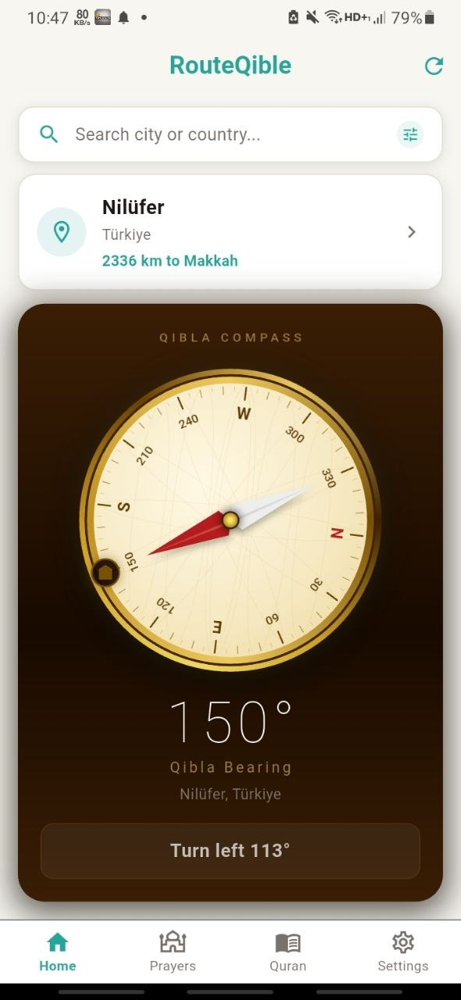
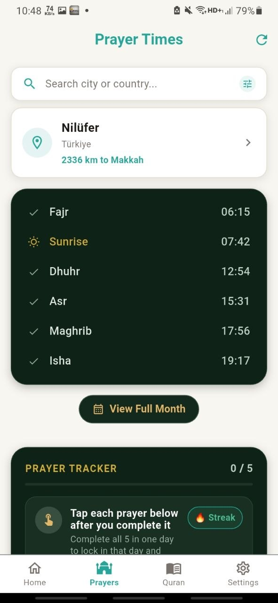
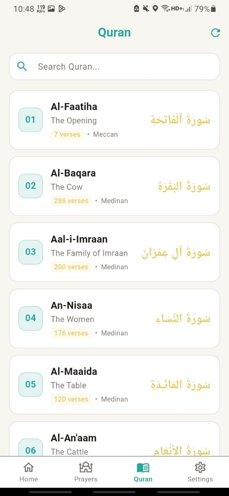
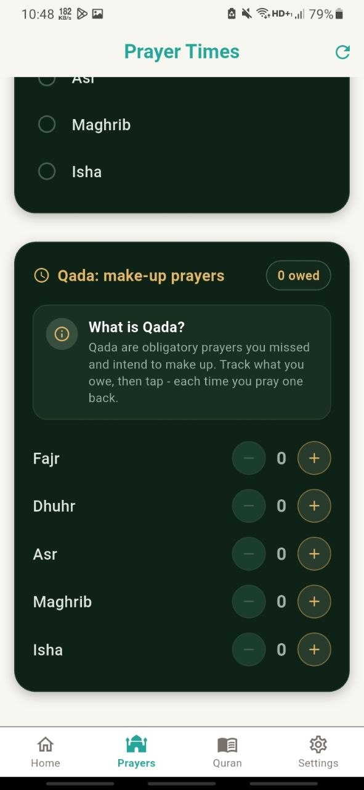
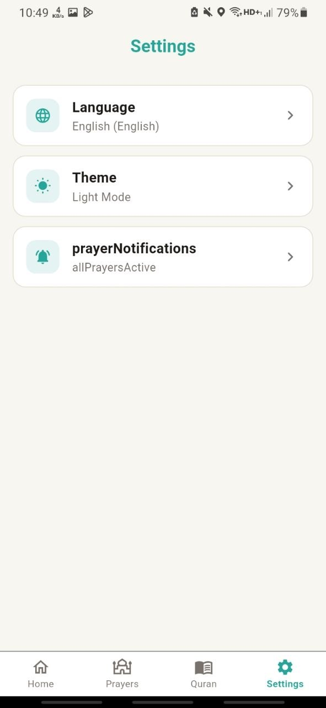

# RouteQibla

RouteQibla is a Flutter app for everyday Muslim worship. It brings Qibla direction, local prayer times, Quran reading, and simple worship trackers together in one place.

Screenshoots 







## Features

- **Qibla compass:** Find the direction of the Kaaba using your device compass, with alignment guidance and a compass calibration hint.
- **Location options:** Use GPS or search for and save a location manually.
- **Prayer times:** Calculate daily prayer times for your location, view a monthly schedule, and see a countdown to the next prayer.
- **Prayer reminders:** Configure local notifications for individual prayers.
- **Prayer tracking:** Keep track of daily prayers and make-up (qada) prayers.
- **Quran:** Browse and search surahs, then read Arabic text with an English translation. Quran content is fetched from [Al Quran Cloud](https://alquran.cloud/).
- **Daily worship tools:** Read a verse of the day, use the digital Tasbih counter, and view the Hijri calendar.
- **Personalization:** Choose from the available languages and light or dark themes.

## Getting started

### Requirements

- Flutter SDK with Dart 3.13 or later
- A configured Flutter target (Android and iOS are supported by the project)

### Run the app

```bash
git clone https://github.com/suhailkhaleqi/routeqible.git
cd routeqible
flutter pub get
flutter run
```

For Qibla compass and automatic location, run the app on a device with location permission and compass sensor support. Quran browsing and reading require an internet connection.

## Run tests

```bash
flutter test
```

## Technology

- Flutter and Dart
- `adhan` for prayer-time calculations
- `geolocator`, `geocoding`, and `flutter_compass` for location and compass features
- `flutter_local_notifications` for local prayer reminders
- Al Quran Cloud REST API for Quran chapters and verses

## Project structure

```text
lib/
  core/          Localization and theme
  models/        App, prayer, and Quran data models
  screens/       App screens
  services/      Location, prayer, Quran, compass, and tracker logic
  widgets/       Reusable UI components
test/            Unit and widget tests
```
